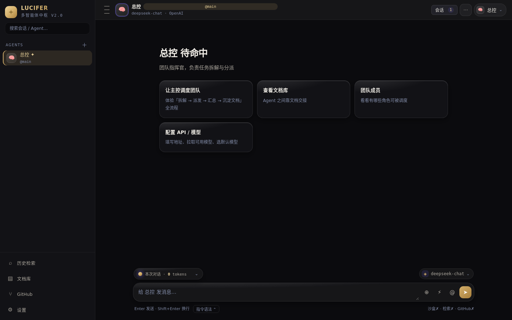
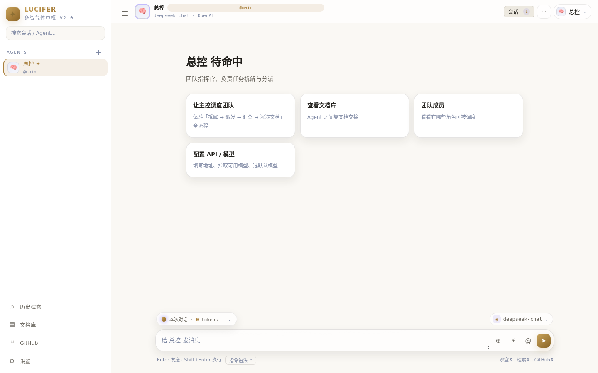
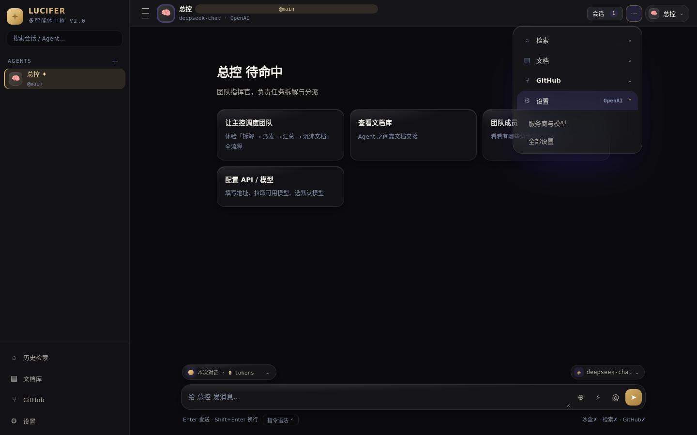
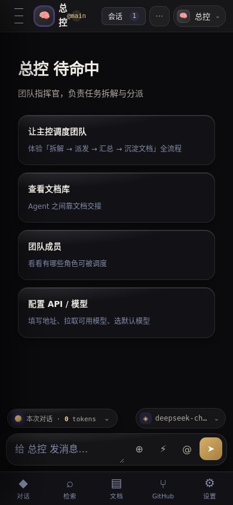

# LUCIFER · 晨星

> **多智能体中枢** —— 一个「总控 Agent 统一发号施令」的 AI 工作台。
> 单文件 Web 应用，可装成 PWA / Windows 桌面端 / 安卓 App；数据全部留在本机。

<p align="center">
  
</p>

<p align="center">
  
  
  
</p>

---

## 这是什么

一个本地优先的 AI 工作台：你给一个**总控 Agent** 下命令，它把活拆开派给团队里的其他 Agent，
自己调用云沙盒跑代码、联网查资料、读写 GitHub 仓库，需要交接内容时用文档在 Agent 之间传。

- **命名**：取自个人站 *Lucifer*。拉丁语义「晨星 / 启明星 / 光之使者」（*lux* 光 + *ferre* 带来）。
- **界面**：鎏金 + 暖黑（v4 设计系统）。深浅双主题，主色 / 圆角 / 字号 / 玻璃强度均可调。
- **不联网也能跑界面**：单个 `index.html` 双击即用，不需要构建、不需要后端。

## 截图

| 暗金 | 亮白 |
|---|---|
|  |  |

| 右上角「工具」二级菜单 | 移动端 |
|---|---|
|  |  |

---

## ✨ 能力

### 多智能体协作
- **主控调度**：主控 Agent 用 `<call agent="@角色名">任务</call>` 派活，前端自动调用并把结果回传，
  循环到收敛（轮次可调）。子 Agent 被派发时**无头执行**——不污染主对话，只回传结论。
- **Agent 管理**：名字 / **角色名**（供主模型识别）/ 头像（Emoji · URL · 上传）/ 简介 / 系统提示词；
  每个 Agent 可独立配模型与服务商，并单独开关能力。
- **Skills**：从 GitHub 直拉（仓库根自动找 SKILL.md / tree 子目录 / raw 链接 / LobeHub skill 页），
  内容注入该 Agent 的系统提示词。

### 内置工具（Agent 可直接调用）
| 工具 | 指令 | 说明 |
|---|---|---|
| **云沙盒** | `<sandbox>print(3**2)</sandbox>` | 两种模式：① e2b 兼容 REST　② **你自己的服务器**（云 / 本地） |
| **联网检索** | `<search>关键词</search>` | SearXNG（自建免费）/ Tavily / Brave / Serper |
| **GitHub** | `<gh op="write" repo="o/r" path="a.md">内容</gh>` | 建仓库 / 读文件 / 提交 / 看 CI / 触发 CI |
| **文档** | `<doc op="create" title="X">正文</doc>` | create / append / update / read / list / delete，Agent 之间靠它交接 |

### 对话
- **图片 / 文件**：点 ⊕、拖拽、或直接粘贴；图片走多模态，文本文件自动注入正文
- **对话内浏览文档**：Agent 产出的文档变成对话里的文档卡片，点开右侧抽屉看全文
- **Agent 自由读文档**：短文档（≤1500 字）全文注入提示词，长文档给摘要 + 按需 `<doc op=read>`
- **会话中心**：右上角统一管理「新对话 + 按 Agent 分组的全部历史」，点任意会话可跨 Agent 直接跳转
- **全文检索**：跨会话搜历史消息
- **导出**：当前会话导出为 ZIP

### 模型接入
统一按 **OpenAI 兼容协议**接入——官方 / 中转站 / 自建代理 / 本地推理都行，
只需填 Base URL + API Key，点「拉取可用模型」即可。支持多套配置随时切换。
> 实测 DeepSeek / OpenAI / GLM / Moonshot 等均返回正常 CORS，可直连；
> 地址不写协议头时会自动判断（内网走 http，公网走 https）。

---

## 🚀 快速开始

### Web（PWA，可安装到桌面 / 手机主屏）

```bash
git clone https://github.com/shibry88-netizen/lucifer.git
cd lucifer
node serve.mjs            # → http://localhost:5180
```

`index.html` 是构建产物，也可以直接双击打开。

### Windows 桌面端

```bash
npm install
npm run tauri:dev         # 开发
npm run tauri:build       # 出安装包（nsis + msi）
npm run electron:build    # 备选：Electron（会关闭同源校验，第三方 API 直连更稳）
```

Tauri 走系统 WebView2，安装包只有 ~1.4 MB。CI 在 `windows-latest` 上自动产出两种安装包。

### 安卓端

```bash
bash android/build.sh     # → android/build/LUCIFER-release.apk
```

不依赖 Gradle：`aapt` → `javac` → `D8` → `zipalign` → `apksigner`，
用 Debian 原生 build-tools（因为构建机是 aarch64，官方 SDK 的 x86_64 工具跑不动）。
签名配置见 `android/RELEASE.md`。

> 安卓端没有起 `file://`（null origin 会让 CORS 与 Service Worker 全废），
> 而是由 `LocalServer.java` 在 `127.0.0.1` 起一个本地 HTTP 服务，页面从
> `http://127.0.0.1:<port>/` 加载，拿到标准 http 源。

---

## 🛠 目录结构

```
index.html            构建产物（别手改）
build.mjs             把 src/ 内联成单文件 + new Function() 语法自检
dist.mjs              整理 PWA 资源到 dist/（给 Tauri / Electron / Capacitor 用）
serve.mjs             本地静态服务

src/
  shell.html          骨架，占位符 /*__CSS__*/ 与 /*__JS__*/
  style.css           设计系统 + 移动端断点 + 浮层体系 + 组件
  app.part1.js        工具 / Markdown / THEMES / 状态 / API / 指令解析 / modal()
  app.part2.js        渲染与交互 + runTurn 调度循环 + 设置页 + 全局事件
  app.part3.js        主题引擎 / 视图路由 / 会话 / 文档抽屉 / 检索 / 沙盒 RPC
  app.part4.js        工具调度 execToolOp / 检索 / ZIP / 附件 / GitHub
  app.part5.js        浮层管理 / ☰ 菜单 / 工具菜单 / Agent 菜单 / 会话中心 / 服务商面板

android/              安卓工程（见 android/README.md 与 RELEASE.md）
electron/             Electron 备选桌面端
src-tauri/            Tauri 工程
.github/workflows/    ci.yml（构建同步校验 + 语法 + PWA + Playwright 冒烟）、windows.yml
screenshots/          截图
```

**执行顺序陷阱**：`boot()` 在 part5 末尾触发。part3/4/5 顶层的 `const` 会被 part2 的
`renderShell()` 引用，提前启动会踩 TDZ。

**加一个工具**：① part1 加 `RE_XXX` + 在 `extractDirectives` push　② `stripDirectives` replace 掉
③ part4 的 `execToolOp` 加分支 + `opHtml` 加渲染。

---

## 🎨 设计系统

v4「鎏金黑 · 静谧」。全部走 CSS 变量，`THEMES` 提供主色预设 + HSL 滑杆自定义。

```css
--accent-h:42; --accent-s:56%; --accent-l:62%;   /* 鎏金 */
--dur-quick:160ms; --dur-base:240ms; --dur-slow:360ms;
--ease-out:cubic-bezier(.22,1,.36,1);
--r-xs:7px; --r-sm:11px; --r-md:16px; --r-lg:20px; --r-xl:26px;
```

约定：**只动画 `transform` / `opacity` / `filter`**，玻璃层绝不参与过渡；
位移 ≤10px、缩放 ≥.985、无过冲弹跳；支持 `prefers-reduced-motion`。

---

## ⚠️ 已知限制

- **数据存在 localStorage**：换浏览器 / 清缓存会丢，建议定期「导出全部数据」
- **QQ / 抖音接入**：需要开放平台 OAuth + IP 白名单，纯前端跑不通，得配后端代理
- **安卓端目前是 WebView 外壳**：相机 / 通知 / 后台任务等原生能力需要写 Java 桥接
- **云沙盒 / 检索 / GitHub 需要你自己填 Key**，不内置任何凭据

## Roadmap

- [ ] 会话 / 文档导出为单页 HTML
- [ ] 安卓原生能力 Java 桥接（相机 / 通知 / 后台）
- [ ] 可选后端代理（解决第三方 OAuth 与 CORS 兜底）
- [ ] 多设备同步

## 签名密钥

APK 用正式密钥签名。**密钥不在本仓库**，密文放在私有仓
[`lucifer-secrets`](https://github.com/shibry88-netizen/lucifer-secrets)，解密口令与参数见
`android/RELEASE.md`。

## License

MIT
